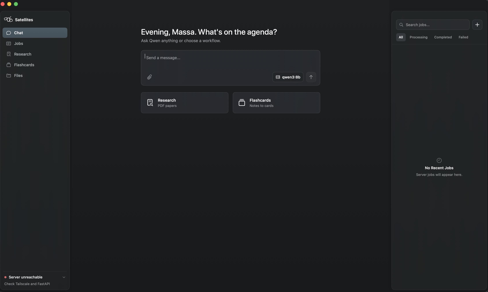
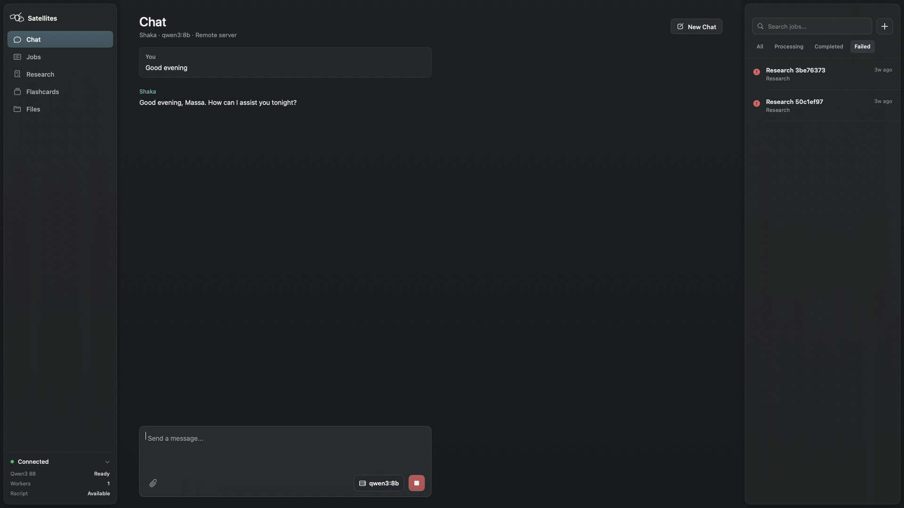
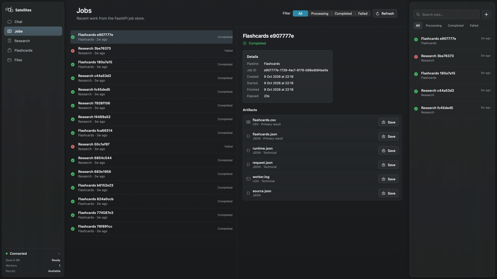
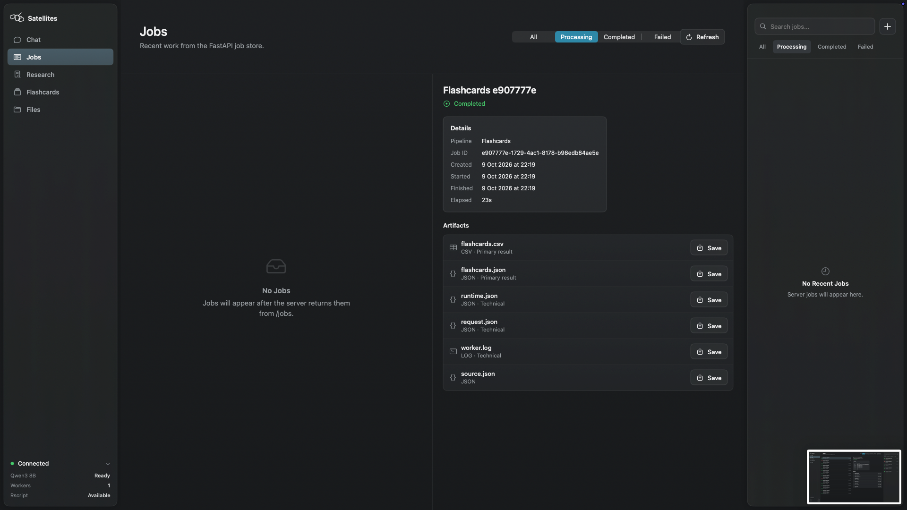
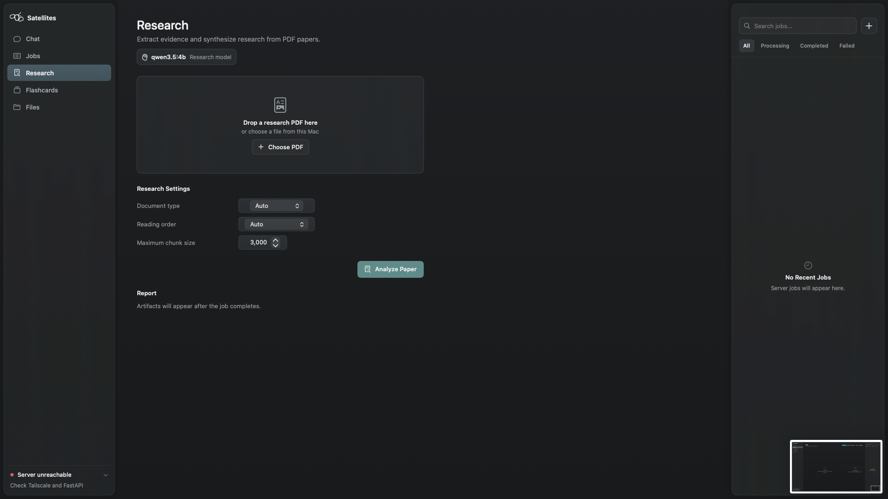

<h1> Satellites</h1>

**A native macOS window onto AI running on your own server.**

Satellites brings chat and file-based workflows into a calm desktop interface. A Python service handles model calls, background jobs, and downloadable results, so the computer running the model can be separate from the one in your hands.

## Inside the app



*The home screen: a place to start a conversation or choose a workflow.*



*A conversation in the macOS interface.*



*Job history, status, and generated files.*



*A selected flashcard job and its artifacts.*



*The PDF research workflow.*

## What Satellites does

The macOS screenshots show the desktop experience: chat, research, flashcards, files, and job monitoring in one interface. The source in this repository contains the **Python backend and CLI**. The `macos/` directory is empty in this checkout, so the client implementation and its build settings cannot be inspected or built from here. The screenshots illustrate the supplied app; the capabilities below are verified against the backend source.

The backend runs [Ollama](https://ollama.com/) locally on the server machine. Its API accepts files, queues work, and stores results for later download. A client may connect across a private network when the server is configured for remote access. “Local AI” here means the model runs on infrastructure you control; requests still travel between the client and server.

### Available through the backend

- **Chat:** `POST /chat/stream` streams responses from `qwen3:8b`. The client supplies conversation messages; the server does not persist chat history. The API can return a memory-save proposal when explicitly requested, leaving persistence to the client.
- **Research PDFs:** Submit a text-native PDF for source extraction, evidence validation, and a cited Markdown report. The job also produces structured evidence, coverage, and diagnostic files. Image-only PDFs are rejected; generated conclusions still warrant human review.
- **Flashcards:** Turn UTF-8 text notes into question-and-answer cards, exported as JSON and CSV. The pipeline validates model output and removes duplicate questions.
- **Datasets:** Clean and inspect CSV data, quarantine ambiguous rows, export Parquet, DuckDB, and Excel files, and run requested statistical analyses through R. Optional model-written interpretation uses the computed results. Review repairs, exclusions, and statistical assumptions before relying on an analysis.
- **Jobs and artifacts:** File workflows return a job ID. `GET /jobs` and `GET /jobs/{id}` expose status, while artifact endpoints download results and available diagnostics. The CLI can run the same three file pipelines directly.

The screenshots show a native client, but its source is absent from this repository. The bullets above describe backend routes and CLI paths; they do not assert that every backend option is exposed by the pictured interface.

## How it works

```text
macOS client (shown above) ── HTTP ──> FastAPI server ──> Ollama / Qwen
                                      │
                                      ├──> one background job worker
                                      │      ├── research: PDF → evidence → report
                                      │      ├── flashcards: TXT → JSON + CSV
                                      │      └── dataset: CSV → cleaned data → R statistics
                                      │
                                      └──> SQLite job state + stored artifacts
```

Chat streams directly from the server. File uploads enter a serial worker; the API responds with a job ID before processing finishes. The backend holds job state in SQLite and stores outputs under `outputs/api/` by default. One Uvicorn worker and one heavy job at a time are intentional parts of this implementation.

**Built with:** Python, FastAPI, Pydantic, Ollama, Qwen, SQLite, pdfplumber, Polars, DuckDB, R, and `jsonlite`. The supplied screenshots show a macOS interface, but Swift and SwiftUI dependencies cannot be verified from source in this checkout.

## Get started with the backend

The checked-in dependency versions were developed with Python 3.13. You also need Ollama with `qwen3:8b`. Dataset statistics require R and its `jsonlite` package. Research can use another installed Ollama model through `LOCAL_AI_RESEARCH_MODEL`; its default is `qwen3:8b`.

```bash
python3.13 -m venv .venv
source .venv/bin/activate
python -m pip install -r requirements.txt
ollama pull qwen3:8b
Rscript --vanilla -e 'install.packages("jsonlite", repos="https://cloud.r-project.org")'
```

Start Ollama using its installation's usual method, then start the API from the repository root:

```bash
source .venv/bin/activate
python -m uvicorn app.api:app --host 127.0.0.1 --port 8000 --workers 1
```

Open `http://127.0.0.1:8000/docs` for the locally served API interface. Submit a TXT, PDF, or CSV through its pipeline endpoint, then use the returned job ID with `GET /jobs/{id}` and the listed artifact URLs. `GET /health` reports whether Ollama models and `Rscript` are available; it does not run an inference test.

The CLI provides another route into the file workflows:

```bash
python -m app flashcards path/to/notes.txt
python -m app research path/to/paper.pdf
python -m app dataset path/to/data.csv
```

For a CSV with a specific analysis plan, see [`config/analysis.example.json`](config/analysis.example.json) and pass it with `python -m app dataset path/to/data.csv --analysis-plan config/analysis.example.json`. CLI output is written beneath `outputs/jobs/` unless you choose another jobs root.

### Connecting from another machine

Loopback requests can run without an API key. For non-loopback access, set `LOCAL_AI_API_KEY` **before** starting the server and send that value in the `X-API-Key` header. Bind Uvicorn to an address reachable only on a network you control; the API's key check is not a substitute for keeping the service off the public internet. Ollama is configured at `http://127.0.0.1:11434` on the server machine, so the model service itself need not be exposed to the client.

```bash
export LOCAL_AI_API_KEY='replace-with-a-long-random-secret'
python -m uvicorn app.api:app --host 0.0.0.0 --port 8000 --workers 1
```

Use a private network or VPN and its assigned server address in the client. This checkout has no macOS source or Xcode project, so it cannot provide a verified client build procedure or a verified screen for entering the server address and key. No minimum macOS or Xcode version is asserted here.

## Repository map

```text
app/
  api.py             FastAPI routes, uploads, authentication, downloads
  cli.py             Command-line entry point
  core/              Chat, model access, job orchestration
  pipelines/         Research, flashcards, dataset processing
  r/                 Statistical calculations
config/              Example analysis and source profiles
docs/                Backend documentation and README images
scripts/             Smoke and verification utilities
tests/               Regression tests
macos/               Empty in this checkout
```

The backend API lives in [`app/api.py`](app/api.py); the file-processing dispatch is in [`app/worker.py`](app/worker.py). [`requirements.txt`](requirements.txt) pins Python packages. The root of this checkout contains no project license file; the license under `app/static/swagger/` covers the vendored Swagger UI assets, not the whole repository.
